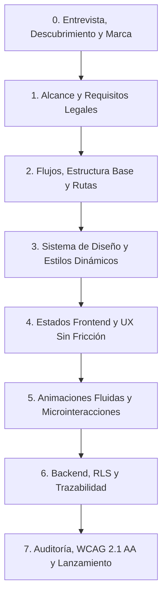

# Estándares y Directrices para Agentes de IA Autónomos en Desarrollo Web

> **Estándar universal para ingeniería asistida por IA, agentes autónomos y equipos de desarrollo full-stack.**  
> Diseñado para crear aplicaciones web de alto rendimiento, seguras, humanas, accesibles y listas para producción.

---

## 0. Protocolo Obligatorio: Entrevista Interactiva de Inicio (Onboarding)

> [!IMPORTANT]
> **REGLA FUNDAMENTAL PARA EL AGENTE DE IA:** Antes de escribir, modificar o estructurar una sola línea de código del proyecto, el agente **DEBE** iniciar una entrevista interactiva con el usuario. El agente recopilará las respuestas a las siguientes 5 dimensiones para adaptar la arquitectura, el estilo visual, los textos y el marco legal:

### 1. Identidad de Marca y Contexto Visual
- **Nombre de la Empresa y Misión:** ¿Cómo se llama el negocio, qué hace y qué valor aporta a sus clientes?
- **Logotipo y Recursos Visuales:** ¿Cuáles son los colores predominantes, formas y personalidad del logo? El agente debe extraer los tokens de color (Primario, Acento, Fondo, Superficie) y sugerir combinaciones tipográficas armonizadas con este ancla visual.
- **Tono y Personalidad de Marca:** Lujo, clínico/dermatológico, minimalista, orgánico/botánico, técnico/desarrollador, fresco/divertido o institucional.

### 2. Productos, Servicios y Modelo de Negocio
- **Oferta Comercial:** Productos físicos (e-commerce), descargas digitales, suscripciones SaaS, consultorías/citas o captura de clientes potenciales (leads).
- **Oferta Estrella:** ¿Cuál es el producto principal o el objetivo central de conversión?

### 3. Casos de Uso y Requisitos del Sistema
- **Requisitos Funcionales:** Capacidades exactas del usuario (navegación de catálogo, bolsa de compras en tiempo real, checkout multi-paso, agendamiento de citas, test de diagnóstico interactivo, pedidos directos a WhatsApp, calificaciones y comentarios por estrellas, motor de cupones de descuento).
- **Requisitos No Funcionales:** Metas de rendimiento (Core Web Vitals: LCP < 2.5s, CLS < 0.1, INP < 200ms), estándar de accesibilidad (WCAG 2.1 Nivel AA), diseño móvil prioritario (*mobile-first*) y cero saltos de diseño (*layout shift*).

### 4. Elección de Infraestructura, Servidor y Base de Datos
El usuario tiene total libertad para elegir cualquier proveedor de nube o base de datos. El agente debe consultar qué stack prefiere y ofrecer la recomendación de referencia de este estándar:
- **Hosting en el Borde y DNS Recomendado:** **Cloudflare Pages & Workers** (CDN global instantánea, ejecución serverless en el borde con ultra baja latencia, seguridad nativa y cero arranques en frío).
- **Base de Datos y Autenticación Recomendada:** **Supabase (PostgreSQL)** (Row-Level Security estricto para aislamiento multi-inquilino, transacciones relacionales ACID, sesiones seguras en cookies HttpOnly y almacenamiento cifrado).
- *Flexibilidad Abierta:* Si el usuario prefiere AWS, Vercel, Firebase, Docker, MySQL, SQLite o MongoDB, el agente debe adaptar la arquitectura limpiamente sin romper la separación de responsabilidades.

### 5. Jurisdicción Legal y Cumplimiento Normativo
- **Jurisdicción de Operación:** ¿En qué país o marco legal opera la aplicación? (ej: Colombia: Ley 1581 / SIC, Unión Europea: RGPD, Estados Unidos: CCPA / FTC, México: LFPDPPP).
- **Contenido Legal Obligatorio:** Redactar a medida las páginas obligatorias: `/terminos`, `/privacidad`, `/cookies` y canal de atención de peticiones, quejas y reclamos (PQRS / Soporte).
- **Trazabilidad Auditable de Consentimiento:** Guardar IP del cliente, marca de tiempo UTC del servidor, versión de las políticas aceptadas y consentimiento booleano explícito.

---

## 1. Principios Fundamentales y Arquitectura

### Arquitectura Limpia y Separación de Responsabilidades
- **Separación Explícita de Archivos:** Mantén cada lenguaje en archivos dedicados (`.html`, `.css`, `.js`, `.ts`). Evita estilos en línea, scripts incrustados en atributos o archivos monolíticos desordenados.
- **Elección por Ajuste Real:** Prioriza soluciones ligeras y probadas que maximicen el rendimiento, claridad y mantenimiento sobre capas innecesarias de librerías.
- **Acceso Sin Fricción (Cero Barreras Artificiales):** Nunca ocultes ni bloquees el catálogo, precios, bolsa de compras o flujo de checkout detrás de inicios de sesión obligatorios. Permite que el visitante explore, añada al carrito y compre con total fluidez.

### Redacción Humana y Directa (Estándar Anti-Texto de IA)
- **Cero Redundancias de IA:** Prohibido el texto inflado, introducciones robóticas, descripciones obvias y adjetivos artificiales (ej: *"en el bullicioso mundo digital de hoy", "solución revolucionaria e integral"*).
- **Directo, Conciso y Humano:** Títulos cortos, descripciones prácticas y botones con etiquetas claras y naturales (ej: *"Añadir"*, *"Pedir por WhatsApp"*, *"Confirmar Pedido"*).

### Interactividad Directa en la Página (In-Place)
- Prefiere interacciones directas en la misma página (formularios limpios, acordeones fluidos, selectores de estrellas directos) sobre ventanas modales invasivas o menús desplegables pesados.

---

## 2. Pila Tecnológica Recomendada

| Capa | Tecnología Recomendada | Propósito |
| :--- | :--- | :--- |
| **Estilos y Sistema de Diseño** | Tailwind CSS / Variables CSS | Estilos escalables basados en tokens y diseño responsivo rápido |
| **Componentes de Interfaz** | Headless UI Accesible / WAI-ARIA | Primitivas de interfaz sin estilos obligados, modulares y accesibles |
| **Animación y Dinamismo** | GSAP (GreenSock) y Motion (Framer) | Líneas de tiempo interactivas de alta precisión y gestos táctiles fluidos |
| **Carruseles y Medios** | Swiper.js | Carruseles acelerados por hardware con soporte táctil prioritario |
| **Iconografía y Tipografía** | Lucide Icons (SVG) y Tipografías de alto contraste | Iconos profesionales y limpios (cero emojis informales en la interfaz) |
| **Hosting en el Borde y DNS** | Cloudflare Pages / Workers / Edge Rules | Computación en el borde global con mínima latencia y máxima seguridad |
| **Persistencia y Autenticación** | Supabase (PostgreSQL + RLS) / SQLite Edge | Integridad relacional con seguridad a nivel de fila y sesiones firmadas |

---

## 3. Metodología Estricta en 7 Pasos de Desarrollo



### Paso 1: Alcance, Casos de Uso y Cumplimiento Legal
- Definir las rutas exactas del usuario y los límites transaccionales.
- Responder las 3 preguntas legales obligatorias:
  1. *¿Qué datos personales específicos se recopilan y con qué finalidad?*
  2. *¿Bajo qué jurisdicción legal opera la transacción?*
  3. *¿Qué garantías, políticas de devolución y compromisos comerciales se ofrecen?*

### Paso 2: Contenido, Flujos de Conversión y Rutas Obligatorias
- Construir embudos completos y ciclos de vida del usuario.
- Incluir obligatoriamente las páginas legales estatutarias:
  - `/terminos` (Términos y Condiciones)
  - `/privacidad` (Política de Privacidad)
  - `/cookies` (Política de Cookies y Banner de Consentimiento)
  - Canal de atención directa al cliente (PQRS / Soporte)

### Paso 3: Sistema de Diseño, Teoría del Color y Jerarquía Visual

> [!TIP]
> **PREVENCIÓN DE DISEÑOS CLÓNICOS (REGLA ANTI-PLANTILLAS):** El agente tiene estrictamente prohibido usar siempre la misma combinación cliché (ej: negro, gris y dorado para "lujo"). La paleta debe ser 100% única para cada cliente siguiendo estas 3 anclas:

1. **El Logotipo como Ancla Cromática Maestra:**
   - Extraer obligatoriamente los valores hexadecimales dominantes del logotipo o empaques provistos por el usuario.
   - Si el logo tiene un tono verde esmeralda, azul zafiro, terracota o cobalto, toda la armonía de la página se construye derivada de ese tono exacto.

2. **Diferenciación de Personalidad por Industria:**
   - **Lujo Orgánico / Cosmética / Bienestar:** Tonos botánicos, verde bosque, oliva cálido, arena o lino con acentos champaña o bronce (nunca fondos negros fríos o genéricos).
   - **Lujo Tecnológico / SaaS / Fintech:** Grafito mate, azul cobalto, violeta espacial o pizarra con sutiles transparencias (*glassmorphism*).
   - **Lujo Gastronómico / Restaurantes:** Burdeos (rojo vino), arcilla, crema cálido y cobre.
   - **Lujo Minimalista / Moda:** Blanco roto, gris perla, negro carbón y un único acento vibrante intencional.

3. **La Proporción Visual Armónica 60-30-10:**
   - **60% Lienzo Dominante:** Fondo general neutro y limpio (marfil, nieve, carbón mate o arena según la personalidad).
   - **30% Estructura y Superficie:** Tarjetas, divisores, paneles y barras secundarias con textura o contraste sutil.
   - **10% Acento de Conversión:** El color de máxima vibración extraído del logotipo, reservado exclusivamente para botones de acción (*CTA*), precios activos y enlaces clave.

4. **Reglas de Construcción Visual:**
   - Combinación tipográfica de alto contraste (fuente display con personalidad para títulos + fuente sans-serif altamente legible para lectura y datos).
   - Escala unificada de espaciados y bordes redondeados consistentes.
   - Iconografía técnica en formato SVG (Lucide Icons); queda prohibido el uso de emojis informales como iconos en interfaces de producción.

### Paso 4: Frontend Robusto y Manejo de Estados
- Cubrir explícitamente los 4 estados fundamentales de cada componente:
  - **Carga (Loading):** Esqueletos elegantes con efecto shimmer o pulso sutil.
  - **Vacío (Empty):** Explicación humana y llamada a la acción clara.
  - **Error (Error):** Mensaje comprensible con opción de reintento directo.
  - **Éxito (Success):** Confirmación limpia, recibo de pedido o retroalimentación inmediata.
- Todo formulario que recolecte datos personales debe incluir **dos casillas independientes de consentimiento, desmarcadas por defecto**:
  - `[ ] He leído y acepto los Términos y Condiciones`
  - `[ ] He leído y acepto la Política de Privacidad`

### Paso 5: Motor de Animación y Rendimiento
- Animar únicamente propiedades compuestas por GPU: `transform` y `opacity`.
- Emplear GSAP ScrollTrigger o Framer Motion para entradas escalonadas y revelaciones al hacer scroll.
- Mantener las microinteracciones por debajo de `300ms` con curvas de aceleración naturales.
- Respetar siempre las preferencias de accesibilidad del usuario mediante `prefers-reduced-motion`.

### Paso 6: Seguridad de Backend y Trazabilidad Auditable (Las 20 Reglas Estrictas)

1. **Row-Level Security (RLS) Obligatorio:** Cada tabla en PostgreSQL debe tener políticas RLS activadas sin excepción; los usuarios solo pueden acceder a sus propios registros.
2. **Cero Fuga de Secretos en Cliente:** Jamás exponer `SERVICE_ROLE_KEY`, tokens administrativos, claves maestras ni credenciales en código cliente o repositorios.
3. **Cookies HttpOnly, Secure y SameSite=Strict:** Almacenar tokens de sesión JWT exclusivamente en cookies cifradas inaccesibles para JavaScript, previniendo ataques XSS.
4. **Protección Anti-CSRF:** Validar cabeceras `Origin` y `Sec-Fetch-Site` en mutaciones de estado (`POST`, `PUT`, `DELETE`).
5. **Límite de Tasa por IP (*Rate Limiting*):** Implementar ventanas deslizantes en endpoints públicos de login, registro, checkout y comentarios para mitigar fuerza bruta y spam.
6. **Protección Anti-IDOR (Insecure Direct Object References):** Autenticar y verificar la pertenencia del recurso en el servidor antes de cualquier lectura o escritura; nunca confiar en un `id` enviado por el cliente.
7. **Validación de Esquema y Sanitización Estricta:** Validar y tipar todas las entradas en el borde y servidor (mediante Zod o equivalente) descartando propiedades no autorizadas.
8. **Consultas SQL Parametrizadas:** Prevenir inyección SQL utilizando bindings y constructores seguros; queda prohibida la concatenación directa de cadenas.
9. **Almacenamiento Criptográfico de Contraseñas:** Emplear únicamente algoritmos robustos con sal única por usuario (PBKDF2 con >100,000 iteraciones, Argon2id o bcrypt con coste >= 12).
10. **Principio de Menor Privilegio (PoLP):** Limitar las claves de API y permisos de base de datos únicamente a las operaciones indispensables requeridas por el frontend.
11. **Cabeceras HTTP de Seguridad Defensivas:** Configurar en el servidor o Cloudflare Headers: `Content-Security-Policy` (CSP), `X-Frame-Options: DENY` (anti-clickjacking), `X-Content-Type-Options: nosniff` y `Referrer-Policy: strict-origin-when-cross-origin`.
12. **Forzado Obligatorio de HTTPS (HSTS):** Habilitar `Strict-Transport-Security` con `max-age=31536000; includeSubDomains; preload` para rechazar cualquier conexión no cifrada.
13. **Sanitización contra Cross-Site Scripting (XSS):** Escapar obligatoriamente cualquier dato renderizado en el DOM mediante funciones de escape HTML antes de insertar contenido dinámico.
14. **Protección de Enlaces Externos:** Todo enlace con `target="_blank"` debe incluir imperativamente `rel="noopener noreferrer"` para evitar ataques de *tabnabbing*.
15. **Rotación y Expiración Estricta de Sesiones:** Definir tiempos de expiración cortos para tokens de sesión y ofrecer invalidación y revocación inmediata al hacer logout.
16. **Protección contra Inyección de Cabeceras y CRLF:** Validar y sanitizar saltos de línea (`\r`, `\n`) en cualquier dato que intervenga en respuestas o cookies del servidor.
17. **Cero Exposición de Trazas de Error (*Stack Traces*):** En producción, capturar excepciones y responder con mensajes humanos genéricos; jamás exponer trazas internas, rutas del servidor ni versiones de base de datos.
18. **Control de Tamaño de Carga Útil (*Payload Limits*):** Rechazar peticiones con tamaños superiores al límite esperado (ej: máximo 1MB para JSON y límites específicos en subidas de imágenes) evitando ataques de denegación de servicio (DoS).
19. **Trazabilidad Auditable de Consentimiento Legal:** Registrar en auditoría inmutable: IP del cliente, marca de tiempo UTC del servidor, versión exacta de los términos aceptados y consentimiento explícito (cumplimiento Ley 1581 / SIC / RGPD).
20. **Validación de Redirecciones (Anti-Open Redirect):** Validar contra una lista blanca interna cualquier parámetro de redirección (`returnTo`, `redirect_url`) antes de transferir al usuario.

### Paso 7: Control de Calidad, Accesibilidad y Despliegue
- Métricas Core Web Vitals: LCP < 2.5s, FID/INP < 200ms, CLS < 0.1.
- Accesibilidad: Cumplimiento de WCAG 2.1 Nivel AA (contraste de color ≥ 4.5:1, control de foco por teclado, etiquetas ARIA).
- SEO y Rastreadores: Generación limpia de `sitemap.xml`, `robots.txt` y metadatos Open Graph.
- Analítica externa (GA4, píxeles de seguimiento): Bloqueada hasta que el usuario otorgue consentimiento explícito de cookies.

---

## 4. Flujo de Trabajo Estándar (Local Primero -> Nube)

1. **Verificación Local Obligatoria:** Todos los cambios, pruebas de integración y comprobaciones de seguridad deben correr y pasar localmente primero.
2. **Despliegue Automatizado a Cloudflare Pages:**
   ```bash
   # Configurar credencial de cuenta Cloudflare
   export CLOUDFLARE_ACCOUNT_ID="tu_cloudflare_account_id"

   # Desplegar aplicación o tienda a producción
   npx wrangler pages deploy ./dist --project-name "mi-proyecto-web" --branch main
   ```
3. **Validación en Vivo:** Comprobar inmediatamente la URL pública desplegada antes de dar por completado el trabajo.

---

## 5. Créditos y Agradecimientos al Ecosistema Abierto

Este estándar sintetiza las mejores prácticas de la comunidad global de código abierto:
- [Tailwind CSS](https://tailwindcss.com) por Tailwind Labs
- [Lucide Icons](https://lucide.dev) por el Proyecto y Comunidad Lucide
- [GSAP](https://gsap.com) por GreenSock
- [Swiper](https://swiperjs.com) por Vladimir Kharlampidi
- [Cloudflare Pages & Workers](https://developers.cloudflare.com/pages/) por Cloudflare
- [Supabase](https://supabase.com) por el Equipo Supabase y la Comunidad PostgreSQL
- [Iniciativa de Accesibilidad Web W3C (WAI-ARIA)](https://www.w3.org/WAI/)

---

## Licencia

Este framework y sus instrucciones son de código abierto bajo la [Licencia MIT](LICENSE).  
Siéntete libre de usarlo, compartirlo y adaptarlo para tus propios agentes de IA, repositorios y proyectos.
