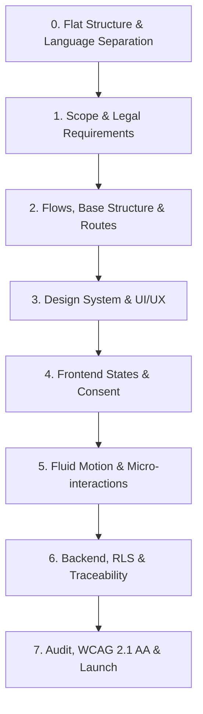

# Standards and Guidelines for Autonomous AI Agents in Web Development

> **Universal standard for AI-assisted engineering, autonomous agents, and full-stack development teams.**  
> Designed for building high-performance, compliant, secure, and production-grade web applications.

---

## 1. Core Principles & Architecture

### 0. Clean Architecture & Separation of Concerns
- **Explicit File Separation:** Keep languages separated in dedicated files (`.html`, `.css`, `.js`, `.ts`) directly aligned to modern web modularity or root structures. Avoid mixing inline stylesheets or inline scripts whenever possible.
- **Problem-Fit Selection:** When choosing between languages, libraries, or architectures, always prioritize the option that delivers the highest real-world performance, clarity, security, and maintainability.
- **Dependency Pragmatism:** Prefer lightweight, battle-tested, standard ecosystem libraries over convoluted abstractions.

---

## 2. Recommended Technology Stack

| Layer | Recommended Technology | Purpose |
| :--- | :--- | :--- |
| **Styling & Design System** | Tailwind CSS / CSS Variables | Scalable token-based styling and rapid responsive layouts |
| **Component Philosophy** | Accessible Headless UI / WAI-ARIA | Unstyled, modular, accessible interface primitives |
| **Motion & Dynamics** | GSAP (GreenSock) & Motion (Framer) | High-precision interactive timelines and declarative gesture animations |
| **Carousels & Media** | Swiper.js | Touch-first, responsive, hardware-accelerated carousels |
| **Icons & Typography** | Lucide Icons (SVG) & High-contrast typography | Clean professional iconography (zero informal emojis in production UI) |
| **Edge Hosting & DNS** | Cloudflare Pages / Workers / Edge Rules | Ultra-low latency, globally distributed edge computing and security |
| **Persistence & Auth** | Supabase (PostgreSQL + RLS) / SQLite Edge | Relational integrity with strict Row-Level Security and signed sessions |

---

## 3. Strict 7-Step Development Methodology



### Step 1: Scope, Use Cases & Legal Compliance
- Define exact user journeys and transaction boundaries.
- Formulate the 3 mandatory legal questions:
  1. *What specific personal data is collected and why?*
  2. *Under which legal jurisdiction does the transaction operate?*
  3. *What warranties, refund terms, and commercial promises are offered?*

### Step 2: Content, User Flows & Mandatory Routes
- Build complete conversion funnels and user lifecycles.
- Always include mandatory statutory pages:
  - `/terminos` (Terms & Conditions)
  - `/privacidad` (Privacy Policy)
  - `/cookies` (Cookie Policy & Consent Banner)
  - Direct support / customer claims channel (PQRS / Support Tickets)

### Step 3: Design System & Visual Hierarchy
- Define a restrained palette: neutral canvas, distinct borders, and a single intentional accent color.
- High-contrast, legible typography pairing (display + sans-serif).
- Unified spacing scale and Lucide SVG icons (never emojis in production UI elements).

### Step 4: Robust Frontend & State Management
- Explicitly cover all 4 fundamental UI states:
  - **Loading:** Subtle shimmer/pulse skeletons.
  - **Empty:** Clear explanation and actionable prompt.
  - **Error:** Human-readable message with a retry mechanism.
  - **Success:** Clear confirmation, receipt code, or feedback.
- Forms collecting personal data must incorporate **two independent, unchecked-by-default legal checkboxes**:
  - `[ ] I accept the Terms and Conditions`
  - `[ ] I accept the Privacy Policy`

### Step 5: Animation Engine & Performance
- Animate only GPU-friendly composite properties: `transform` and `opacity`.
- Use GSAP ScrollTrigger or Framer Motion for scroll-reveals and staggered entrances.
- Keep micro-interactions under `300ms` with natural cubic-bezier easing.
- Respect user accessibility preferences via `prefers-reduced-motion`.

### Step 6: Backend Security & Audit Traceability
Enforce the standard **20 Security Rules**:
1. **Row-Level Security (RLS):** Strict multi-tenant isolation on every table.
2. **Zero Secret Leaks:** Never expose Service Keys, private tokens, or connection strings in client code.
3. **HttpOnly & SameSite Cookies:** Secure token storage with CSRF protection.
4. **IP Rate Limiting:** Enforce sliding-window rate limits on all public and mutation endpoints.
5. **Anti-IDOR Protection:** Authenticate and authorize every read/write against user ownership, never trust client-provided IDs.
6. **Input Sanitization & Schema Validation:** Validate with Zod or equivalent schemas on both client and edge.
7. **SQL Parameterization:** Prevent injection attacks by never concatenating raw query strings.
8. **Cryptographic Password Storage:** Use PBKDF2 / Argon2 / bcrypt with per-user salt.
9. **Consent Traceability:** Store client IP, server timestamp (UTC), legal version accepted, and consent booleans for data audits.
10. **Principle of Least Privilege:** Scope API keys strictly to required tables and actions.

### Step 7: Quality Assurance, Accessibility & Deployment
- Core Web Vitals targets: LCP < 2.5s, FID/INP < 200ms, CLS < 0.1.
- Accessibility: WCAG 2.1 Level AA compliance (contrast ratio ≥ 4.5:1, keyboard focus management, ARIA labels).
- SEO & Crawlers: Generate clean `sitemap.xml`, `robots.txt`, and Open Graph metadata.
- Third-party analytics (e.g. GA4, Pixels) must remain blocked until explicit cookie consent is granted.

---

## 4. Standard Deployment Workflow (Local First -> Cloud)

1. **Local-First Verification:** All changes, unit tests, and security assertions must run and pass locally first.
2. **Automated Cloudflare Pages Deployment:**
   ```bash
   # Set cloud account credentials
   export CLOUDFLARE_ACCOUNT_ID="your_cloudflare_account_id"

   # Deploy production storefront or application
   npx wrangler pages deploy ./dist --project-name "my-web-project" --branch main
   ```
3. **Edge Validation:** Perform immediate live health checks on the deployed edge URL before notifying completion.

---

## 5. Credits & Ecosystem Acknowledgments

This standard synthesizes best practices from the global open-source community:
- [Tailwind CSS](https://tailwindcss.com) by Tailwind Labs
- [Lucide Icons](https://lucide.dev) by Lucide Project & Community
- [GSAP](https://gsap.com) by GreenSock
- [Swiper](https://swiperjs.com) by Vladimir Kharlampidi
- [Cloudflare Pages & Workers](https://developers.cloudflare.com/pages/) by Cloudflare
- [Supabase](https://supabase.com) by Supabase Team & PostgreSQL Community
- [W3C Web Accessibility Initiative (WAI-ARIA)](https://www.w3.org/WAI/)

---

## License

This framework and its instructions are open-source and released under the [MIT License](LICENSE).  
Feel free to use, share, and adapt it for your own AI agents, repositories, and development projects.
